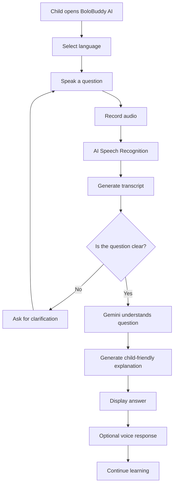
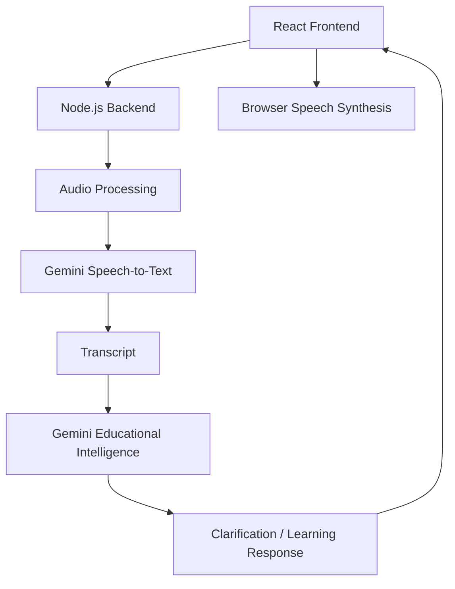

# 🎙️ BoloBuddy AI
### Your Voice. Your Language. Your Learning Buddy.

<p align="center">
  An AI-powered, voice-first learning companion designed to make education more accessible, interactive, and inclusive for children aged 6–14.
</p>

<p align="center">
  
  
  
  
</p>

<p align="center">
  <a href="#-about-the-project">About</a> •
  <a href="#-key-features">Features</a> •
  <a href="#-how-it-works">How It Works</a> •
  <a href="#-technology-stack">Tech Stack</a> •
  <a href="#-getting-started">Setup</a> •
  <a href="#-roadmap">Roadmap</a>
</p>

---

## 🌟 About the Project

**BoloBuddy AI** is an AI-powered educational companion that allows children to ask questions naturally using their voices and receive simple, understandable explanations.

Traditional speech technologies are often designed around adult speech patterns. However, children may communicate differently through variations in pronunciation, speaking speed, accents, pauses, incomplete sentences, and multilingual conversations.

BoloBuddy aims to bridge this gap by combining speech recognition with conversational AI to create a more inclusive learning experience.

Our goal is simple:

> Every child deserves to be heard, understood, and encouraged to learn.

## 🎯 The Problem We Address

Children don't always speak like adults.

Some common challenges include:

- Different accents and pronunciation patterns.
- Fast or slow speaking speeds.
- Pauses, hesitation, and incomplete sentences.
- Background noise.
- Hindi-English code-switching.
- Difficulty expressing complicated questions.

A speech recognition system may misunderstand a child's question and consequently provide an irrelevant answer.

**Our approach:** Listen carefully, preserve the original meaning, identify possible uncertainty, ask for clarification, and explain concepts in child-friendly language.

## ✨ Key Features

| Feature | Description | Development status |
|---|---|---|
| 🎙️ Voice Interaction | Ask educational questions using a microphone | In development |
| 🧠 AI Learning Assistant | Generate simple educational explanations using Gemini | Planned |
| 🌍 Multilingual Support | Hindi, English, Bengali, Tamil, Telugu and Marathi | Planned |
| 💬 Hinglish Understanding | Handle natural Hindi-English conversations | Planned |
| 🔍 Clarification System | Ask follow-up questions when speech is unclear | Planned |
| 📚 Subject Learning | Mathematics, Science, English and more | Planned |
| 🔊 Voice Responses | Listen to answers using browser speech synthesis | Planned |
| 🎯 Interactive Quizzes | Generate learning questions and quizzes | Planned |

*Development status will be updated as features are implemented and tested.*

## 🗣️ Supported Languages

BoloBuddy aims to support:

- 🇮🇳 Hindi
- 🇬🇧 English
- Bengali
- Tamil
- Telugu
- Marathi
- Hindi-English Hinglish

Language availability and recognition quality will be evaluated individually rather than assumed to be equal.

## ⚙️ How It Works



## 🏗️ Proposed Architecture



The application is being developed using Google AI Studio's full-stack application-building environment.

## 🛠️ Technology Stack

| Technology | Purpose |
|---|---|
| React | Frontend development |
| TypeScript | Type-safe application development |
| CSS / Existing UI framework | Responsive interface and styling |
| Node.js | Server-side application logic |
| Google Gemini API | Educational intelligence |
| Gemini Transcription | Speech-to-text processing |
| MediaRecorder API | Browser audio recording |
| SpeechSynthesis API | Spoken educational responses |
| Git & GitHub | Version control |

*The final stack may be adjusted based on actual implementation and model availability.*

## 🚀 Getting Started

### 1. Clone the repository

```bash
git clone https://github.com/YOUR_USERNAME/bolobuddy-ai.git
```

### 2. Open the project

```bash
cd bolobuddy-ai
```

### 3. Install dependencies

For an npm-based project:

```bash
npm install
```

### 4. Configure Gemini API

Generate an API key through [Google AI Studio](https://aistudio.google.com/api-keys).

For the full-stack Google AI Studio deployment, configure the key using the server-side Secrets panel.

Secret name:

```env
GEMINI_API_KEY=your_api_key
```

Never commit your actual API key to GitHub or expose it in frontend code.

### 5. Start the development server

For a project with an npm `dev` script:

```bash
npm run dev
```

Follow the actual project scripts and deployment instructions if they differ.

## 🔐 Privacy & Security

BoloBuddy is designed for children, so privacy matters.

Our development principles include:

- Secure server-side API key management.
- No unnecessary collection of personal information.
- No permanent storage of microphone recordings by default.
- Temporary audio cleanup after processing.
- Appropriate consent before using children's identifiable recordings.
- Clear microphone permission handling.
- Responsible use of third-party AI services.

## 🗺️ Roadmap

- [x] Establish BoloBuddy AI identity and product concept.
- [x] Develop the initial landing page.
- [ ] Implement microphone recording.
- [ ] Integrate real speech-to-text processing.
- [ ] Connect Gemini educational intelligence.
- [ ] Implement multilingual question handling.
- [ ] Build uncertainty detection and clarification.
- [ ] Add spoken AI responses.
- [ ] Introduce interactive quizzes.
- [ ] Evaluate recognition quality using test datasets.
- [ ] Complete end-to-end testing.
- [ ] Prepare hackathon demonstration.

## 📊 Our Innovation

BoloBuddy is not intended to be just another question-answering chatbot.

Its central idea is to make voice-based learning more accessible to children who may not communicate in the same way as adult users.

We aim to combine:

- Voice-first interaction.
- Multilingual communication.
- Uncertainty-aware clarification.
- Age-appropriate educational explanations.
- Inclusive learning experiences.

Recognition quality and child-speech performance will be evaluated through testing before making accuracy claims.

## 🤝 Contributing

Contributions, suggestions, and feedback are welcome!

If you would like to contribute:

1. Fork this repository.
2. Create a new feature branch.
3. Make your changes.
4. Test your implementation.
5. Submit a pull request describing your contribution.

## 👨‍💻 Project Information

**Project:** BoloBuddy AI  
**Category:** Artificial Intelligence / EdTech  
**Target Audience:** Children aged 6–14  
**Development Environment:** Google AI Studio  
**AI Platform:** Google Gemini

## 📌 Acknowledgements

- Google AI Studio and Gemini.
- The open-source developer community.
- Everyone working towards accessible and inclusive education.

---

<p align="center">
  <b>Made with ❤️ to make every child's voice count.</b>
  <br/>
  <i>BoloBuddy AI — Your Voice. Your Language. Your Learning Buddy.</i>
</p>
